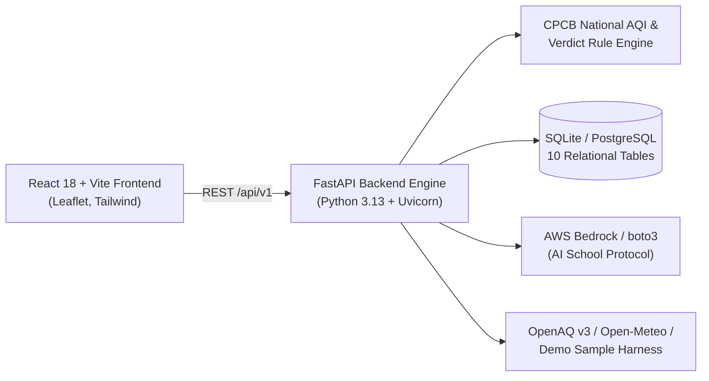

# AirTrack 🌿

> **"Track what's in the air, warn the people most exposed to it, and change what happens on the bad days."**  
> *Built for Environmental Hacks (Event 02, Bharat Builds Tour - WeMakeDevs x AWS) • Track 01: Air*

---

## 1. Overview & Impact

Existing environmental applications present air pollution as a passive number (e.g., *"AQI 348"*). For Indian school coordinators, parents, and asthmatic citizens, numbers fail to answer the critical questions:
- **"Is it safe for children to hold morning sports assembly outdoors today?"**
- **"Is this reading measured by an active ground station or estimated by a stale model?"**

**AirTrack** converts raw pollution telemetry into **transparent, explainable verdicts** (`SAFE`, `LIMIT_OUTDOOR`, `AVOID_OUTDOOR`, `STAY_INDOORS`) strictly mapped to official **Central Pollution Control Board (CPCB)** guidelines.

### Key Capabilities
- **Explainable Audience Verdicts:** Contextual recommendations for `School & Children`, `General Public`, and `Asthma / Seniors`.
- **School Air Safety Protocol:** Automated directives for morning assemblies, PE recess, classroom HEPA air management, and a 1-click WhatsApp parent announcement draft.
- **Data Transparency & Provenance:** Every data point is explicitly tagged as `MEASURED` (OpenAQ/CPCB), `MODELED` (Open-Meteo), or `SAMPLE` (Demo Harness), with freshness tags (`FRESH` vs `STALE`).
- **Geospatial Hotspots & Stubble Burning:** Interactive Leaflet map displaying Delhi-NCR stations with an overlay of satellite active crop residue fires in Punjab/Haryana and prevailing wind vectors.
- **AWS Integration:** Engineered using the official AWS open-source SDK (`boto3`) and Amazon Bedrock with deployable Amazon S3/CloudFront and App Runner configurations.

---

## 2. Architecture



---

## 3. Quickstart: Run Locally

### Prerequisites
- **Node.js**: v18+ (tested on Node v22)
- **Python**: 3.11+ (tested on Python 3.13)

### Step 1: Start the Backend REST API
```bash
cd airtrack/backend

# Create virtual environment & install dependencies
python -m venv .venv
.\.venv\Scripts\pip.exe install -r requirements.txt

# Launch FastAPI server (port 8000)
.\.venv\Scripts\python.exe -m uvicorn app.main:app --port 8000 --host 127.0.0.1
```
*API Swagger Documentation is live at:* **`http://localhost:8000/docs`**  
*Health Check (Actuator) is live at:* **`http://localhost:8000/actuator/health`**

### Step 2: Start the React Frontend Web App
```bash
cd airtrack/frontend

# Install dependencies (cached)
npm install

# Start Vite development server (port 5173)
npm run dev
```
*Open your browser at:* **`http://localhost:5173/`**

---

## 4. Automated Test Suite Results

Run the full backend test suite:
```bash
cd airtrack/backend
.\.venv\Scripts\pytest.exe -v
```

**Verified Test Results (33 Passed, 100% Success Rate):**
- `test_pm25_sub_indices` PASSED
- `test_pm10_sub_indices` PASSED
- `test_aqi_category_mapping` PASSED
- `test_compute_aqi_from_pollutants` PASSED
- `test_all_18_verdict_combinations` (18 parametrized tests) PASSED
- `test_health_actuator` PASSED
- `test_search_locations` PASSED
- `test_search_locations_validation_error` (RFC 7807) PASSED
- `test_get_stations` PASSED
- `test_get_current_air_quality_with_provenance` PASSED
- `test_get_verdict_children_school` PASSED
- `test_get_verdict_not_found_rfc7807` PASSED
- `test_get_history` PASSED
- `test_get_hotspots` PASSED
- `test_get_sources` PASSED
- `test_auth_flow` (Register, Login, JWT Profile) PASSED

---

## 5. Hackathon Deliverables Index

- **Demo Video Script (3 Minutes):** [`docs/DEMO.md`](docs/DEMO.md)
- **AWS Builder Center Blog Draft:** [`docs/blog-outline.md`](docs/blog-outline.md)
- **AWS Cloud Deployment Guide:** [`deployment/AWS.md`](deployment/AWS.md)
- **Data Source Evaluation & Evidence:** [`docs/data-sources.md`](docs/data-sources.md)
- **System Architecture & ER Diagrams:** [`docs/architecture.md`](docs/architecture.md)
- **Master Phase Checklist:** [`checklist.md`](checklist.md)
