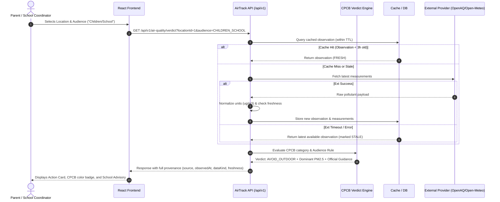
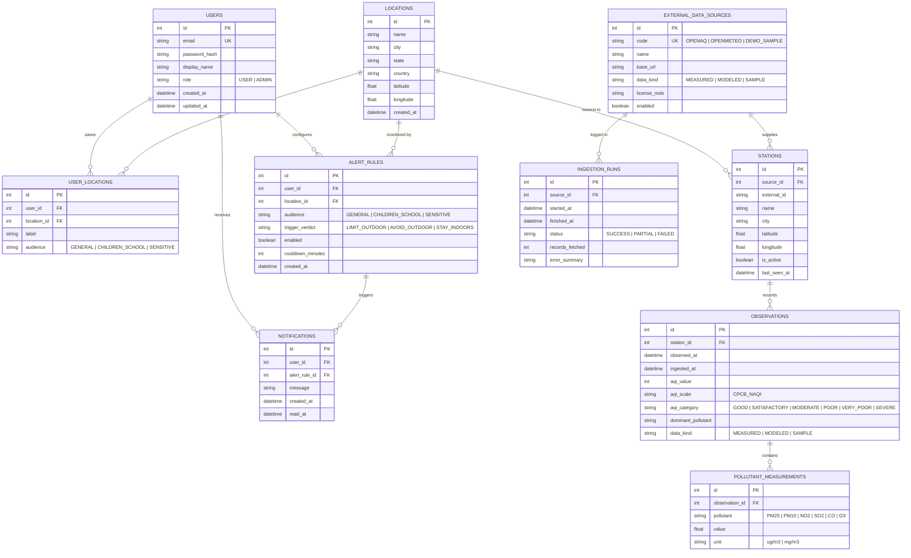
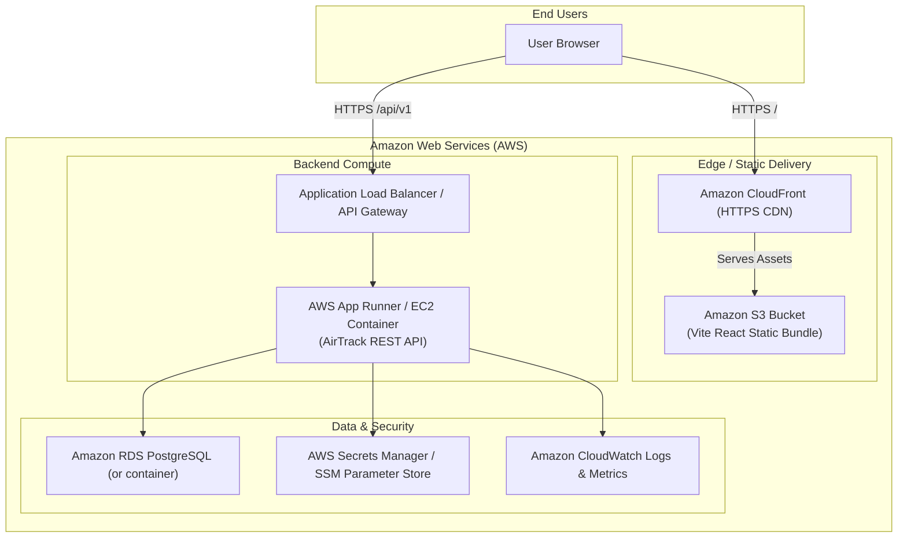

# AirTrack: System Architecture & Technical Design

**Document Status:** Approved (Phase 2 Deliverable)  
**Version:** 1.0  
**Scope:** Full architectural blueprints, data flows, schemas, API contracts, and AWS deployment mapping.

---

## 1. High-Level System Architecture

```mermaid
flowchart TB
    subgraph ClientTier["Client Tier (React 18 + Vite Web App)"]
        UI["AirTrack Responsive Dashboard\n(Tailwind CSS, Lucide Icons)"]
        MapEngine["Interactive Map Engine\n(Leaflet + OpenStreetMap)"]
        ChartEngine["Trends & History\n(Recharts)"]
        StateEngine["API & Cache Client\n(TanStack Query / Axios)"]
        UI --> MapEngine
        UI --> ChartEngine
        UI --> StateEngine
    end

    subgraph APITier["Application & API Tier"]
        Gateway["REST API Controller (/api/v1)\n(OpenAPI 3.0 / Swagger UI)"]
        AuthModule["JWT Security & Auth Module\n(BCrypt Hashing)"]
        VerdictEngine["CPCB National AQI & Audience Verdict Engine"]
        IngestScheduler["Ingestion & Sync Service\n(Scheduled + On-Demand Trigger)"]
        CacheLayer["In-Memory Cache Layer\n(TTL: 15 min for observations)"]
        
        Gateway --> AuthModule
        Gateway --> VerdictEngine
        Gateway --> CacheLayer
        IngestScheduler --> CacheLayer
    end

    subgraph DataAccess["Data Access & Storage"]
        DB[(Relational DB: PostgreSQL / SQLite)\n(Append-only Observations, Stations, Users)]
        CacheLayer --> DB
        IngestScheduler --> DB
    end

    subgraph ExternalProviders["External Air Quality Data Sources"]
        P1["Primary: OpenAQ v3 API\n(Station MEASURED)"]
        P2["Fallback: Open-Meteo API\n(Atmospheric MODELED)"]
        P3["Demo Seed Provider\n(Guaranteed Offline SAMPLE)"]
    end

    StateEngine -->|HTTPS /api/v1| Gateway
    IngestScheduler -->|HTTP + Rate-Limiting| P1
    IngestScheduler -.->|Fallback on Failure| P2
    IngestScheduler -.->|Demo Mode Active| P3
```

---

## 2. Data Flow Pipeline

Every data ingestion and retrieval follows a strict 6-stage lifecycle to guarantee data provenance and prevent stale data propagation:



---

## 3. Entity Relationship (ER) Schema

The database design implements 10 justified tables with primary keys, foreign keys, unique constraints, and optimized indexes:



---

## 4. REST API Specification (`/api/v1`)

All error responses strictly adhere to the **RFC 7807 Problem Details** format:
```json
{
  "type": "https://airtrack.local/errors/invalid-parameter",
  "title": "Invalid Request Parameter",
  "status": 400,
  "detail": "Query parameter 'q' must be between 2 and 100 characters.",
  "instance": "/api/v1/locations/search",
  "code": "INVALID_QUERY_LENGTH",
  "correlationId": "req-98f7e2a1"
}
```

### 4.1 Public Endpoints
| Method | Path | Parameters | Response Summary |
| :--- | :--- | :--- | :--- |
| `GET` | `/locations/search` | `q` (string, 2..100) | Array of matched locations with coordinates. |
| `GET` | `/stations` | `lat`, `lon`, `radiusKm` (1..100, default 25) | Nearby stations with active status. |
| `GET` | `/air-quality/current` | `locationId` OR `lat`, `lon` | Latest observation, all pollutants, provenance. |
| `GET` | `/air-quality/verdict` | `locationId`, `audience` | Computed verdict (`SAFE`, `LIMIT_OUTDOOR`, etc.), explanation, rule cited. |
| `GET` | `/air-quality/history` | `stationId`, `from`, `to`, `interval` | Historical time-series points (24h or 7d). |
| `GET` | `/air-quality/hotspots` | `city`, `limit` (1..50) | Ranked stations by AQI descending. |
| `GET` | `/sources` | none | Active data sources, licenses, update intervals. |
| `GET` | `/actuator/health` | none | System health check (DB, cache, memory). |

### 4.2 Authentication Endpoints
| Method | Path | Request Body | Response Summary |
| :--- | :--- | :--- | :--- |
| `POST` | `/auth/register` | `{ email, password, displayName }` | User ID, display name, JWT token. |
| `POST` | `/auth/login` | `{ email, password }` | JWT bearer token, user profile. |
| `GET` | `/users/me` | Bearer Token header | Current authenticated user profile. |

### 4.3 User Endpoints (JWT Required)
| Method | Path | Auth | Purpose |
| :--- | :--- | :--- | :--- |
| `GET / POST / DELETE` | `/me/locations` | User JWT | Manage saved locations (Home, School). |
| `GET / POST / PUT / DELETE`| `/me/alert-rules`| User JWT | Manage alert thresholds (enforces user ownership). |
| `GET` | `/me/notifications`| User JWT | Fetch in-app notifications. |
| `PATCH` | `/me/notifications/{id}/read` | User JWT | Mark notification as read. |

### 4.4 Admin Endpoints (ROLE_ADMIN Only)
| Method | Path | Auth | Purpose |
| :--- | :--- | :--- | :--- |
| `GET` | `/admin/ingestion-runs`| Admin JWT | View paginated ingestion logs and provider latencies. |
| `POST` | `/admin/ingestion/trigger` | Admin JWT | Trigger immediate synchronous or async data sync. |

---

## 5. Provenance & Provenance Envelope Contract

Every air quality observation returned to the frontend **must** carry the provenance header:
```json
{
  "aqiValue": 328,
  "aqiScale": "CPCB_NAQI",
  "aqiCategory": "VERY_POOR",
  "dominantPollutant": "PM2.5",
  "source": {
    "id": "OPENAQ",
    "name": "OpenAQ Ground Station (CPCB Anand Vihar)",
    "license": "ODC-BY"
  },
  "dataKind": "MEASURED",
  "freshness": "FRESH",
  "observedAt": "2026-10-10T05:30:00Z",
  "ingestedAt": "2026-10-10T05:42:00Z",
  "pollutants": {
    "PM2.5": { "value": 178.4, "unit": "ug/m3" },
    "PM10": { "value": 312.0, "unit": "ug/m3" },
    "NO2": { "value": 68.2, "unit": "ug/m3" },
    "CO": { "value": 2.4, "unit": "mg/m3" }
  }
}
```

---

## 6. AWS Deployment Architecture


